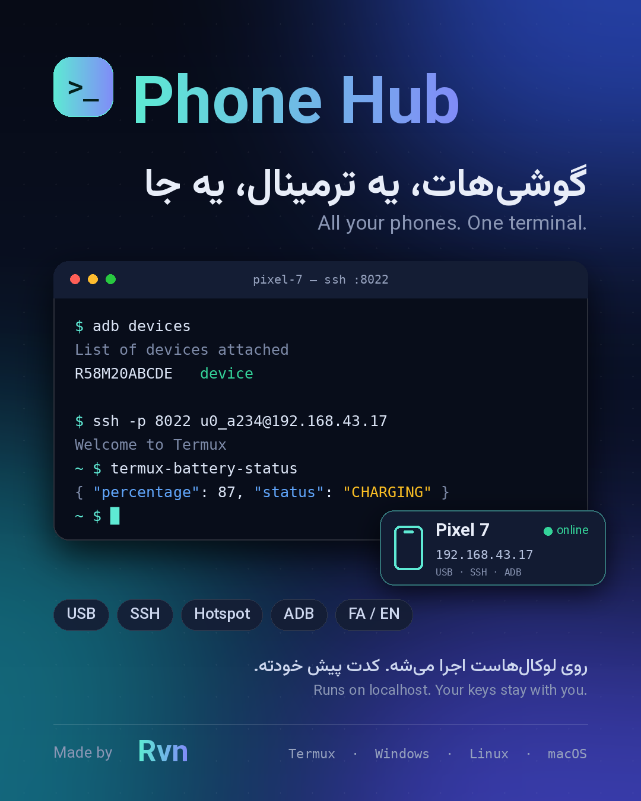

<div align="center">



# Phone Hub

**گوشی‌هات، یه ترمینال، یه جا**

مدیریت گوشی‌های اندروید و ترمینال کامل داخل مرورگر؛ با USB، هات‌اسپات یا SSH. روی سیستم خودت اجرا می‌شه و هیچ داده‌ای جایی نمی‌ره.

🇮🇷 **فارسی** · [🇬🇧 ENG](README.en.md)

</div>

<div dir="rtl">

## ✨ امکانات

- **ترمینال کامل داخل سایت** با چند تب، چند تم، تغییر اندازه فونت، دستورهای آماده و کلیدهای کمکی برای موبایل (Esc، Ctrl، Tab، فلش‌ها)
- **ترمینال همین دستگاه** با دسترسی کامل؛ روی گوشی (Termux)، ویندوز، لینوکس و مک
- **لیست گوشی‌ها** با IP فعلی، **IPهای قبلی** و وضعیت آنلاین (SSH / USB)
- **افزودن گوشی با USB** (adb): IP و یوزرنیم Termux خودکار پیدا می‌شه
- **افزودن با هات‌اسپات / وای‌فای**: اسکن شبکه و پیداکردن گوشی‌هایی که SSH روشن دارن
- **ترمینال USB** مستقیم با `adb shell` (بدون نیاز به Termux)
- **متن فارسی راست‌چین و متصل** داخل ترمینال (دکمه `RTL` روی نوار ترمینال)
- **فارسی و انگلیسی** (دکمه `EN / فا` بالای سایت) + **آموزش فعال‌کردن ADB** داخل سایت

## 🚀 نصب و اجرا

### 📱 روی موبایل (Termux)

[Termux](https://f-droid.org/packages/com.termux/) رو از F-Droid یا GitHub نصب کن (نسخه Play Store قدیمیه).

```bash
pkg install -y unzip
termux-setup-storage
cp ~/storage/downloads/phone-hub.zip ~ && unzip phone-hub.zip && cd phone-hub
bash termux-install.sh
python app.py
```

لینکی که چاپ می‌شه خودکار باز می‌شه (یا دستی کپیش کن توی مرورگر گوشی).

> ⚠️ روی Termux هیچ‌وقت `pip install cryptography` نزن؛ با Python جدید خراب می‌شه. `termux-install.sh` نسخه درست رو از `pkg` می‌گیره.
> حالت USB/adb روی خود گوشی کار نمی‌کنه؛ از «دستی» یا «اسکن» استفاده کن.

### 🪟 ویندوز

1. [Python 3.10+](https://www.python.org/downloads/) رو نصب کن (تیک **Add Python to PATH** رو بزن).
2. زیپ رو Extract کن و روی **`run.bat`** دابل‌کلیک کن.
3. برای حالت USB: `winget install Google.PlatformTools`

### 🐧 لینوکس / 🍎 مک

```bash
sudo apt install python3 python3-venv adb   # مک: brew install python android-platform-tools
unzip phone-hub.zip && cd phone-hub
./run.sh
```

بار اول وابستگی‌ها خودکار نصب می‌شن. پورت دیگه می‌خوای: `PORT=5001 ./run.sh`

## 🔐 اولین ورود

برنامه یه لینک شخصی چاپ می‌کنه:

```
http://127.0.0.1:5000/?k=XXXXXXXX
```

اولین باری که `http://127.0.0.1:5000` رو باز کنی **خودکار وارد می‌شی** و مرورگر یادش می‌مونه. اگه مرورگر دیگه‌ای خواستی یا کوکی پاک شد، لینک بالا رو باز کن یا توکن رو (`cat data/.token`) توی صفحه قفل وارد کن. چون ترمینال لوکال دسترسی کامل می‌ده، بقیه مرورگرها بدون توکن وارد نمی‌شن.

## 📱 اضافه‌کردن گوشی

| روش | کار |
|---|---|
| **USB** | گوشی رو وصل کن، USB debugging رو روشن کن، «افزودن گوشی ← USB» |
| **هات‌اسپات** | هات‌اسپات رو روشن کن، سیستم رو وصل کن، «افزودن گوشی ← اسکن» |
| **دستی** | IP، پورت (پیش‌فرض ۸۰۲۲)، یوزرنیم و پسورد |

آموزش قدم‌به‌قدم فعال‌کردن ADB (حتی بی‌سیم) داخل خود سایت، تب **آموزش ADB** هست.

برای SSH روی گوشی، توی Termux بزن (یا از سایت «ارسال اسکریپت راه‌اندازی» رو بزن):

```bash
pkg install -y openssh && passwd && sshd
```

## 🛡️ امنیت

- سایت فقط روی `127.0.0.1` گوش می‌ده و Host/Origin چک می‌شه.
- دسترسی با توکن شخصی (`data/.token`) محافظت می‌شه.
- پسورد فقط اگه تو فرم بنویسی ذخیره می‌شه (`data/devices.json`). خالی بذار تا هر بار بپرسه یا از کلید SSH استفاده کن.
- پورت رو به اینترنت باز نکن.

## 🧰 مشکلات رایج

| مشکل | راه‌حل |
|---|---|
| `adb` پیدا نمی‌شه | `adb` رو نصب کن (تب آموزش) و ترمینال رو دوباره باز کن |
| گوشی `unauthorized` | روی گوشی Allow بزن؛ یا Revoke USB debugging authorizations و دوباره وصل کن |
| در Termux ارور `PyLong_Type` | `pip uninstall -y cryptography pynacl` سپس `bash termux-install.sh` |
| ترمینال ویندوز باز نمی‌شه | `pip install pywinpty` |
| پورت ۵۰۰۰ اشغاله | `PORT=5001` |

## 🗂️ ساختار

```
app.py          بک‌اند Flask (API، اسکن، ترمینال وب)
rtl.py          راست‌چین‌سازی متن فارسی خروجی ترمینال
static/         رابط کاربری (فارسی/انگلیسی، xterm.js، فونت‌ها)
phone/          اسکریپت راه‌اندازی SSH برای Termux
termux-install.sh · run.sh · run.bat
```

## ❤️ سازنده

ساخته‌شده توسط **Rvn** · لایسنس [MIT](LICENSE)

</div>
